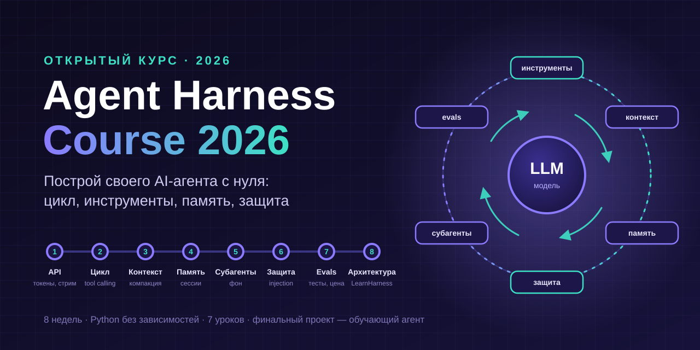
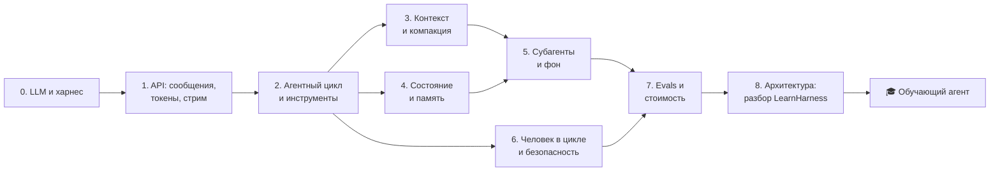
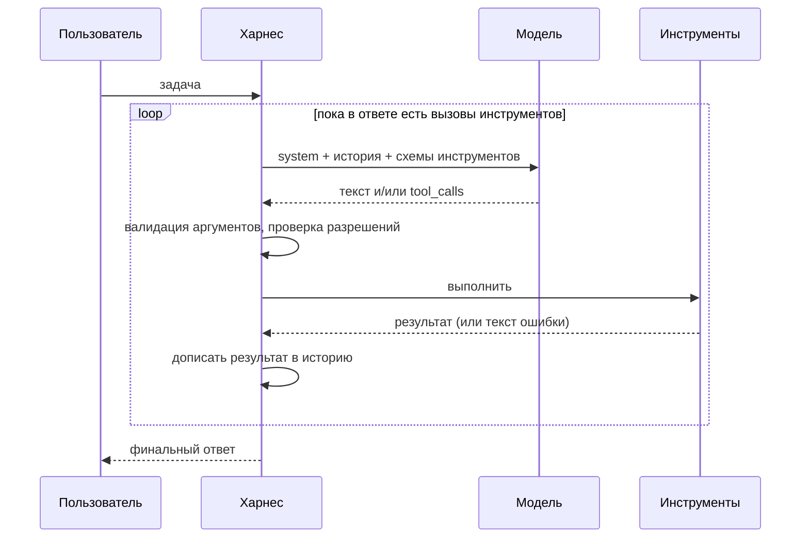
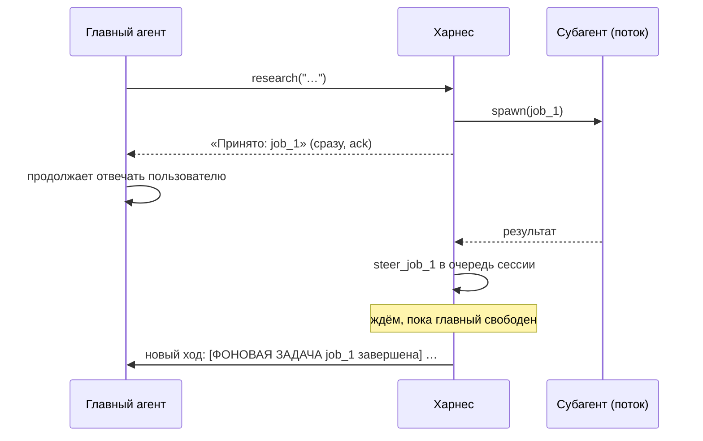
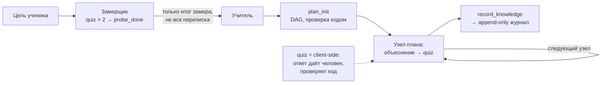

<p align="center">
  
</p>

<p align="center">
  
  
  
  
  
</p>

# 🧠 Agent Harness Course 2026 — как построить своего AI-агента с нуля

> Пошаговый курс на ~8 недель (1–2 часа в день): от одного запроса к LLM до агента с инструментами, памятью, субагентами, защитой и тестами — и финального проекта.
> Свой учебный харнес на чистом Python без единой зависимости, 7 запускаемых уроков, финальный проект, 19 тестов и разбор архитектуры настоящего open-source агента.
[Ai Ml](https://t.me/+2ijKywQaDyo1YzIy) — материал переработан, структурирован и дополнен кодом, схемами и справочниками.

Курс не учит «пользоваться ещё одним фреймворком». Он показывает, **из чего сделан любой агент** — Claude Code, Codex, Cursor, Devin, LearnHarness — и даёт собрать каждую деталь руками. После этого любой фреймворк читается за вечер, а любой баг агента — объясним.

**Три принципа курса:**

- **Сначала работает — потом теория.** Каждый урок начинается с запускаемого скрипта. Все примеры идут **без ключа и без интернета** на «сценарной» модели — а одной переменной окружения переключаются на настоящую LLM.
- **Харнес важнее модели.** Одна и та же модель в хорошем и плохом харнесе — это два разных продукта. Курс учит инженерии вокруг модели: цикл, инструменты, контекст, состояние, безопасность, оценка.
- **Всё измеряется.** Не «агент вроде работает», а «8/10 кейсов eval-набора, $0.04 за задачу, 6 шагов в среднем». Цифры отличают инженера от демо.

---

## О курсе

Агент — это не модель. Модель — функция «текст → текст», она ничего не помнит, ничего не делает и ничего не проверяет. Всё, что делает агента агентом, живёт **вокруг** модели: цикл, который её вызывает; инструменты, которыми она действует; контекст, который ей собирают; память, которая переживает сессию; ограничения, которые не дают ей навредить. Эту обвязку называют **харнесом** (harness — «упряжь»).

```
            ┌───────────────────────── ХАРНЕС ─────────────────────────┐
 человек ──▶│ UI/CLI → сессия → [контекст] → МОДЕЛЬ → вызовы инструментов │──▶ мир
            │    ▲         │        ▲                     │            │   (файлы, API,
            │    │      память   компакция        разрешения, песочница│    браузер…)
            │    └──── стрим, вопросы ◀── субагенты ◀── результаты ◀───┘
            └───────────────────────────────────────────────────────────┘
```

### Для кого

| Ты… | Что получишь |
|---|---|
| бэкенд / фронтенд-разработчик | понимание, как устроены AI-агенты внутри, и навык встроить агента в свой продукт |
| ML / data-инженер | инженерную сторону LLM: инструменты, контекст, состояние, eval, стоимость |
| пользователь Claude Code / Cursor / Copilot | понимание, почему агент ведёт себя так, как ведёт, и как его настраивать |
| студент / начинающий | структурированный путь в самую быстрорастущую область разработки и проекты в портфолио |

**Нужно:** уверенный базовый Python (функции, словари, классы) и терминал. ML-знания не нужны.

### Что будет в конце

- 🛠 **Свой харнес** (~900 строк с комментариями): провайдеры, агентный цикл, инструменты, компакция, память, фоновые субагенты, подтверждения, eval — и ты понимаешь каждую строку.
- 🎓 **Финальный проект** — обучающий агент «замер → план → обучение → журнал знаний», архитектурно как LearnHarness.
- 📊 **Eval-набор** для своего агента и привычка менять промпт только с цифрами до/после.
- 🗣️ Умение объяснить на собеседовании: агентный цикл, tool calling, context engineering, компакцию, prompt injection, evals.

### Формат

| Параметр | Значение |
|---|---|
| Длительность | ~8 недель по 1–2 часа в день ([план по неделям](docs/week-by-week.md)) |
| Стартовый уровень | базовый Python |
| Стоимость | **$0** — все уроки работают без ключа; с реальной моделью — обычно < $5 за весь курс, или бесплатно на локальной модели через Ollama |
| Компьютер | любой с Python 3.10+; GPU нужен только для локальных моделей |
| Зависимости | **ноль** — только стандартная библиотека Python |
| Модели | Anthropic, OpenAI, OpenRouter, DeepSeek, Ollama, LM Studio, vLLM — любой OpenAI-совместимый API |

---

## 🚀 Быстрый старт за 5 минут

```bash
git clone https://github.com/justxor/agent-harness-course.git && cd agent-harness-course

# Без ключа: «сценарная» модель
python examples/02_agent_loop.py            # агент читает файл и считает калькулятором
python examples/capstone/mini_tutor.py      # финальный проект в демо-режиме
python -m unittest discover -s tests        # 19 тестов, без сети

# С настоящей моделью — одна переменная окружения
export LLM_PROVIDER=anthropic LLM_MODEL=<id модели> LLM_API_KEY=sk-...
# или OpenAI-совместимый API (OpenAI, OpenRouter, DeepSeek…)
export LLM_PROVIDER=openai LLM_BASE_URL=https://openrouter.ai/api/v1 LLM_MODEL=<id> LLM_API_KEY=...
# или бесплатно и локально
export LLM_PROVIDER=openai LLM_BASE_URL=http://localhost:11434/v1 LLM_MODEL=qwen3
python examples/01_hello_llm.py
```

> Актуальные id моделей меняются каждые несколько месяцев — бери их со страницы провайдера ([Anthropic](https://platform.claude.com/docs/en/about-claude/models), [OpenAI](https://platform.openai.com/docs/models), [OpenRouter](https://openrouter.ai/models)). Для инструментов выбирай модель, у которой в описании есть tool use / function calling.

## 📚 Справочники в репозитории

| Документ | Зачем |
|---|---|
| 📅 [План по неделям](docs/week-by-week.md) | 8 недель: тема и конкретный результат каждой |
| 🔬 [Разбор LearnHarness](docs/learnharness-case-study.md) | как устроен настоящий open-source агент: слои, системы, протоколы |
| 🔍 [Отладка агентов](docs/debugging.md) | «агент делает ерунду — что проверить» |
| 🛡 [Безопасность агентов](docs/safety.md) | prompt injection, «смертельная триада», чек-лист перед продакшеном |
| 📖 [Глоссарий RU ↔ EN](docs/glossary.md) | 70+ терминов, чтобы читать документацию и статьи |
| 💡 [25 идей проектов](docs/project-ideas.md) | от простого бота до своего coding-агента |
| ❓ [FAQ](docs/faq.md) | какую модель брать, фреймворк или руками, сколько стоит, куда расти |

## Содержание

- [О курсе](#о-курсе) · [Быстрый старт](#-быстрый-старт-за-5-минут) · [Справочники](#-справочники-в-репозитории)
- [Как пользоваться курсом](#как-пользоваться-курсом) · [Карта курса](#карта-курса)
- [Модуль 0. Что такое LLM и почему нужен харнес](#модуль-0-что-такое-llm-и-почему-нужен-харнес-неделя-1)
- [Модуль 1. API моделей: сообщения, токены, стриминг](#модуль-1-api-моделей-сообщения-токены-стриминг-неделя-1)
- [Модуль 2. Агентный цикл и инструменты](#модуль-2-агентный-цикл-и-инструменты-недели-23)
- [Модуль 3. Контекст-инжиниринг и компакция](#модуль-3-контекст-инжиниринг-и-компакция-неделя-4)
- [Модуль 4. Состояние и память](#модуль-4-состояние-и-память-неделя-5)
- [Модуль 5. Субагенты и фоновые задачи](#модуль-5-субагенты-и-фоновые-задачи-неделя-6)
- [Модуль 6. Человек в цикле и безопасность](#модуль-6-человек-в-цикле-и-безопасность-неделя-6)
- [Модуль 7. Evals, наблюдаемость и стоимость](#модуль-7-evals-наблюдаемость-и-стоимость-неделя-7)
- [Модуль 8. Архитектура настоящего харнеса: разбор LearnHarness](#модуль-8-архитектура-настоящего-харнеса-разбор-learnharness-неделя-8)
- [🎓 Финальный проект: обучающий агент](#-финальный-проект-обучающий-агент)
- [🚀 Продвинутые темы](#-продвинутые-темы--куда-расти-после-курса)
- [Частые ловушки](#частые-ловушки) · [Структура репозитория](#структура-репозитория)
- [Ресурсы](#ресурсы) · [Сообщества](#сообщества)

---

## Как пользоваться курсом

1. **Иди по модулям по порядку.** Каждый модуль = идея → код в `harness/` → запускаемый урок в `examples/` → практика → чек-лист.
2. **Сначала запусти урок без ключа**, прочитай вывод, потом прочитай код модуля в `harness/`. Он короткий специально.
3. **Потом запусти тот же урок на реальной модели** и сравни: где модель повела себя иначе, чем сценарий? Это и есть самое интересное.
4. **Практику делай в своём форке.** Ломай харнес, добавляй инструменты, пиши тесты — `tests/test_harness.py` показывает, как тестировать агента без сети.
5. **Веди журнал**: промпт → результат eval → стоимость. Через 8 недель это готовая статья или пост.

## Карта курса



---

## Модуль 0. Что такое LLM и почему нужен харнес (неделя 1)

**Цель:** понимать, что модель умеет сама, а что за неё обязан делать харнес.

**Ключевые идеи:**

- **LLM предсказывает следующий токен.** Токен — кусок слова (в русском тексте ~2–3 символа, в английском ~4). Всё, что модель «знает» в момент ответа, — это веса (знания на дату обучения) + контекст, который ты прислал.
- **Модель stateless.** Между вызовами она не помнит ничего. «Диалог» — иллюзия: харнес каждый раз присылает всю историю заново.
- **Модель не действует.** Она может только *написать*, что хочет вызвать функцию. Выполняет вызов харнес — и он решает, разрешать ли.
- **Агент = модель в цикле с инструментами.** Модель сама решает, какой шаг следующий, по результатам предыдущих. Это отличает агента от «воркфлоу», где шаги прописаны кодом.

**Когда агент НЕ нужен.** Если шаги известны заранее — пиши обычный код с 1–2 вызовами LLM (классификация, извлечение, перевод). Агент — для задач, где путь заранее неизвестен: отладка, исследование, работа с файлами, диалог с уточнениями. Это главный тезис статьи Anthropic [Building effective agents](https://www.anthropic.com/engineering/building-effective-agents) — прочитай её первой.

| Ресурс | Почему |
|---|---|
| [Anthropic — Building effective agents](https://www.anthropic.com/engineering/building-effective-agents) | воркфлоу vs агенты, 5 базовых паттернов; лучший старт |
| [Andrej Karpathy — Intro to Large Language Models](https://www.youtube.com/watch?v=zjkBMFhNj_g) | час о том, что такое LLM, без формул |
| [Andrej Karpathy — Let's build the GPT Tokenizer](https://www.youtube.com/watch?v=zduSFxRajkE) | почему модель «плохо считает буквы» и сколько стоит русский текст |
| [Lilian Weng — LLM Powered Autonomous Agents](https://lilianweng.github.io/posts/2023-06-23-agent/) | классический обзор: планирование, память, инструменты |
| [ReAct (Yao et al.)](https://arxiv.org/abs/2210.03629) | статья, из которой вырос паттерн «рассуждай → действуй → наблюдай» |

**🛠 Практика:** открой любой агент, которым пользуешься (Claude Code, Cursor, ChatGPT с инструментами), и за 30 минут выпиши: какие у него инструменты, что он помнит между сессиями, где спрашивает разрешения, что происходит, когда контекст заканчивается. Это твоя карта того, что предстоит построить.

### ✅ Чек-лист модуля 0
- [ ] Объясняю, почему модель «не помнит» прошлый вызов и кто тогда помнит
- [ ] Отличаю воркфлоу от агента и знаю, когда агент не нужен
- [ ] Понимаю, что такое токен и почему русский текст дороже английского

---

## Модуль 1. API моделей: сообщения, токены, стриминг (неделя 1)

**Цель:** уверенно делать вызовы к любому провайдеру и понимать каждое поле запроса и ответа.

**Код:** [`harness/llm.py`](harness/llm.py) · **Урок:** `python examples/01_hello_llm.py`

**Что внутри запроса:**

- **system** — роль и правила. Самый «весомый» текст для модели.
- **messages** — история: `user` / `assistant` / `tool`. Чередование ролей важно; у Anthropic результаты инструментов идут внутри `user`-сообщения, у OpenAI — отдельной ролью `tool`. Наш `llm.py` прячет эту разницу за одним внутренним форматом — это и есть первая работа харнеса.
- **max_tokens** — лимит ответа. Слишком мало → ответ обрежется посреди вызова инструмента.
- **tools** — JSON Schema инструментов (модуль 2).

**Что внутри ответа:** текст, вызовы инструментов, `usage` (входные/выходные токены), `stop_reason` (закончил сам / упёрся в лимит / хочет инструмент).

**Стоимость — главная метрика, о которой забывают.** Каждый вызов платит за *весь* контекст. Агент на 30 шагов с историей 20k токенов — это 600k входных токенов за задачу. Отсюда: кэширование промптов ([prompt caching](https://platform.claude.com/docs/en/build-with-claude/prompt-caching) — повторяющийся префикс стоит в разы дешевле), компакция (модуль 3), дешёвые модели для простых подзадач (модуль 5).

**Стриминг** — ответ приходит по кусочкам через Server-Sent Events. Нужен не для скорости, а для UX: пользователь видит, что агент работает. Посмотри `stream_text` в `llm.py` — это 15 строк.

| Ресурс | Почему |
|---|---|
| [Anthropic — Messages API](https://platform.claude.com/docs/en/api/messages) | эталонное описание запроса/ответа |
| [OpenAI — Chat Completions / Responses](https://platform.openai.com/docs/api-reference) | второй стандарт де-факто; его копируют почти все |
| [OpenRouter](https://openrouter.ai/docs) | один ключ — сотни моделей; удобно сравнивать |
| [Ollama](https://ollama.com) | локальные модели с OpenAI-совместимым API, бесплатно |

**🛠 Практика:** запусти урок на двух разных провайдерах (например, облачная модель и локальная через Ollama). Сравни токены и цену одного и того же вопроса на русском и на английском. Добавь в `llm.py` повтор при HTTP 429/5xx с экспоненциальной задержкой и джиттером.

### ✅ Чек-лист модуля 1
- [ ] Делаю вызов к двум провайдерам через один интерфейс
- [ ] Читаю `usage` и считаю стоимость запроса
- [ ] Понимаю, зачем стриминг и как устроен SSE
- [ ] Реализовал retry с backoff только для повторяемых ошибок

---

## Модуль 2. Агентный цикл и инструменты (недели 2–3)

**Цель:** написать цикл, в котором модель сама вызывает инструменты, пока не решит задачу.

**Код:** [`harness/loop.py`](harness/loop.py), [`harness/tools.py`](harness/tools.py) · **Урок:** `python examples/02_agent_loop.py`



**Пять правил хорошего цикла** (все реализованы в `loop.py`):

1. **На каждый `tool_call` — ровно один результат.** Даже если инструмент упал или запрещён. Иначе следующий запрос к API отклонят.
2. **Ошибка инструмента — это текст для модели, а не исключение харнеса.** «Файл не найден. Есть: a.txt, b.txt» — модель прочитает и исправится. Падение харнеса — потерянная сессия.
3. **Валидируй аргументы до выполнения.** Модели путают типы и придумывают параметры.
4. **Лимит шагов.** Без него агент в петле сожжёт бюджет.
5. **Логируй траекторию** — имя, аргументы, результат, время каждого вызова. Без этого агента не отладить.

**Как писать инструменты, которыми модель пользуется правильно:**

- **Описание — это промпт.** Пиши, *когда* вызывать: «Используй для ЛЮБЫХ расчётов, не считай в уме».
- **Мало мощных инструментов лучше, чем много мелких.** 5 понятных инструментов > 40 похожих.
- **Возвращай то, что поможет следующему шагу**, а не сырой дамп: обрезай, суммируй, подсказывай («найдено 3, показаны первые 20 строк»).
- **Опасный ввод — только через разбор**, никогда `eval()` / `shell=True` на строке от модели (см. калькулятор в уроке).
- **Параллельные вызовы.** Модель может попросить несколько инструментов за один шаг — урок показывает два калькулятора сразу.

| Ресурс | Почему |
|---|---|
| [Anthropic — Tool use overview](https://platform.claude.com/docs/en/agents-and-tools/tool-use/overview) | форматы, параллельные вызовы, tool_choice |
| [OpenAI — Function calling](https://platform.openai.com/docs/guides/function-calling) | то же у OpenAI; strict-режим схем |
| [Anthropic — Writing effective tools for agents](https://www.anthropic.com/engineering/writing-tools-for-agents) | как проектировать инструменты и проверять их eval'ами |
| [mini-swe-agent](https://github.com/SWE-agent/mini-swe-agent) | coding-агент на ~100 строк — доказательство, что цикл прост |
| [smolagents (Hugging Face)](https://github.com/huggingface/smolagents) | маленький читаемый фреймворк; агенты, пишущие код вместо JSON |

**🛠 Практика:**
1. Запусти урок на реальной модели и задай вопрос, требующий 3+ шагов.
2. Добавь инструмент `grep(pattern)` по рабочей папке. Сделай так, чтобы на пустой результат он подсказывал модели, что попробовать.
3. Сломай описание калькулятора («Иногда можно посчитать»). Посчитай, как часто модель начнёт считать в уме и ошибаться.

### ✅ Чек-лист модуля 2
- [ ] Написал (или переписал) агентный цикл сам и понимаю каждую строку
- [ ] Ошибки инструментов возвращаются модели текстом, а харнес не падает
- [ ] Валидирую аргументы и ограничиваю число шагов
- [ ] Могу показать, как формулировка описания инструмента меняет поведение модели

---

## Модуль 3. Контекст-инжиниринг и компакция (неделя 4)

**Цель:** управлять тем, что модель видит. Это главный рычаг качества после выбора модели.

**Код:** [`harness/context.py`](harness/context.py) · **Урок:** `python examples/03_context_compaction.py`

**Контекст — ограниченный и дорогой ресурс.** Даже у моделей с огромным окном качество падает, когда контекст засорён (это называют *context rot*): модель хуже находит важное среди мусора. Задача харнеса — дать модели **минимальный достаточный** контекст.

**Инструменты контекст-инжиниринга:**

| Техника | Что делает | В курсе |
|---|---|---|
| **Промпт из фрагментов** | системный промпт склеивается из файлов `00-role.md`, `10-rules.md`… Каждый файл — одна ответственность, diff читается в git | `build_system_prompt`, `examples/prompts/` |
| **Компакция** | старую часть истории заменяют сводкой, хвост оставляют дословно | `compact`, `select_cutoff` |
| **Обрезка результатов** | инструмент возвращает 20 строк вместо 20 000 | `read_file` |
| **Загрузка по требованию** | агент сам ищет нужное инструментами, а не получает всё в промпт | модуль 4 |
| **Изоляция** | тяжёлую подзадачу делает субагент со своим контекстом, главному приходит итог | модуль 5 |
| **Починка истории** | «висящие» вызовы без результата получают синтетический INTERRUPTED | `repair_dangling_tool_calls` |

**Правила компакции** (из LearnHarness, который портирует их из pi-coding-agent):

1. Идём с конца, копим токены до бюджета хвоста.
2. **Граница никогда не попадает на результат инструмента** — без своего вызова он бессмыслен и ломает API.
3. Если весь хвост — результаты инструментов, сохраняем их вместе с вызовом.
4. Сводку пишет отдельный вызов модели со своим промптом: цели, решения, факты, что сделано, что осталось.
5. После компакции счётчик контекста сбрасывается, пока не придёт новый реальный замер.

| Ресурс | Почему |
|---|---|
| [Anthropic — Effective context engineering for AI agents](https://www.anthropic.com/engineering/effective-context-engineering-for-ai-agents) | главная статья по теме: компакция, заметки, субагенты |
| [Anthropic — Prompt engineering overview](https://platform.claude.com/docs/en/build-with-claude/prompt-engineering/overview) | как писать системные промпты |
| [12-Factor Agents (HumanLayer)](https://github.com/humanlayer/12-factor-agents) | «владей своим контекстным окном» и ещё 11 принципов |
| [LearnHarness — compaction-accounting.md](https://github.com/amosblomqvist/learnharness/blob/main/docs/compaction-accounting.md) | компакция и учёт токенов в реальном продукте |

**🛠 Практика:** подключи `auto_compactor` к циклу из модуля 2 (`run_agent(..., before_model_call=auto_compactor(llm, 6000, 2000))`). Дай агенту длинную задачу на реальной модели. Проверь: помнит ли агент после компакции имена файлов и принятые решения? Улучши `SUMMARY_PROMPT`, пока не начнёт помнить.

### ✅ Чек-лист модуля 3
- [ ] Собираю системный промпт из фрагментов и храню их в git
- [ ] Объясняю, почему граница компакции не может стоять на результате инструмента
- [ ] Подключил автокомпакцию и проверил, что важные факты её переживают
- [ ] Умею чинить историю после сбоя посреди вызова инструмента

---

## Модуль 4. Состояние и память (неделя 5)

**Цель:** чтобы сессии переживали перезапуск, а знания — сессии.

**Код:** [`harness/memory.py`](harness/memory.py) · **Урок:** `python examples/04_memory.py` (запусти дважды)

**Три уровня памяти:**

| Уровень | Что это | Пример |
|---|---|---|
| **Рабочая** | текущий контекст модели | история сессии |
| **Сессионная** | транскрипт на диске, можно продолжить после падения | `SessionStore` |
| **Долговременная** | факты и знания между сессиями | `FactMemory`, файлы `CLAUDE.md` / `AGENTS.md`, граф знаний LearnHarness |

**Инженерные приёмы, которые встречаются во всех серьёзных харнесах:**

- **Write-ahead.** Сообщение пользователя сохраняется *до* вызова модели. Упал посреди ответа — ничего не потерял.
- **Атомарная запись.** Пишем во временный файл и делаем `os.replace` — файл никогда не окажется наполовину записанным.
- **Append-only журналы (JSONL).** Не изменяем — только дописываем. Текущее состояние *вычисляется* из журнала. Битые строки при чтении пропускаются, а не «угадываются». Удаление — тоже запись (`forget`).
- **Один писатель на хранилище.** В LearnHarness граф знаний пишет только конвейер извлечения — никто больше. Так не бывает гонок и непонятных правок.
- **Извлечение фактов делает отдельный вызов LLM** с инструментом `save_facts`, а не главный агент «по пути».

**Поиск по памяти.** В уроке — по совпадению слов, и урок честно показывает, где это ломается (синонимы). Следующий шаг — эмбеддинги + классический поиск BM25 (гибрид), затем ранжирование. Но часто лучше дать агенту **инструменты поиска** (`grep`, `list_sessions`) и позволить ему искать самому — так делают Claude Code и LearnHarness («учитель исследует граф, ничего не подмешивается»).

| Ресурс | Почему |
|---|---|
| [Anthropic — Memory tool](https://platform.claude.com/docs/en/agents-and-tools/tool-use/memory-tool) | память как файлы, которыми агент управляет сам |
| [MemGPT / Letta](https://github.com/letta-ai/letta) | память как виртуальная память ОС: иерархия и подкачка |
| [AGENTS.md](https://agents.md/) | открытый формат «инструкции для агента в репозитории» |

**🛠 Практика:** добавь в `FactMemory` поиск по эмбеддингам (любой API эмбеддингов или локальная модель) и сравни с поиском по словам на 20 фактах. Добавь инструмент `remember(fact)`, чтобы агент сам решал, что запоминать, — и найди случай, когда он запоминает мусор.

### ✅ Чек-лист модуля 4
- [ ] Сессия переживает `Ctrl+C` посреди ответа модели
- [ ] Понимаю, почему append-only журнал надёжнее перезаписываемого JSON
- [ ] Реализовал извлечение фактов и дедупликацию
- [ ] Знаю, когда подмешивать память в промпт, а когда дать агенту инструмент поиска

---

## Модуль 5. Субагенты и фоновые задачи (неделя 6)

**Цель:** распараллеливать работу и изолировать контекст.

**Код:** [`harness/jobs.py`](harness/jobs.py) · **Урок:** `python examples/05_subagents.py`

**Субагент** — это тот же цикл, но со своим системным промптом, своими инструментами и **чистым контекстом**. Главный агент видит только итог в 300 токенов, а не 30 000 токенов поиска. Это самый сильный приём борьбы с засорением контекста.

**Схема ack-and-steer** (из LearnHarness):



**Exactly-once.** id steer-сообщения детерминирован (`steer_<jobId>`). При повторной доставке (сбой, рестарт) дубль отбрасывается. Статус задачи меняется на «готово» только *после* того, как ход с результатом сохранён.

**Когда мультиагентность вредит.** Параллельные агенты, правящие одни и те же файлы, конфликтуют. Хорошо параллелятся *чтение и исследование*; *запись* — лучше одним агентом. Мультиагентная система тратит в разы больше токенов — это оправдано только для широких задач.

| Ресурс | Почему |
|---|---|
| [Anthropic — How we built our multi-agent research system](https://www.anthropic.com/engineering/multi-agent-research-system) | оркестратор + субагенты в продакшене, цифры и грабли |
| [OpenAI Agents SDK](https://github.com/openai/openai-agents-python) | handoffs и агенты как инструменты — посмотри, как это сделано во фреймворке |
| [Claude Agent SDK — subagents](https://code.claude.com/docs/en/agent-sdk/overview) | субагенты в Claude Code и Agent SDK |

**🛠 Практика:** замени сценарный субагент на реальную модель (дешевле главной) с инструментом чтения файлов. Запусти три исследования параллельно. Измерь: время, токены главного агента со субагентами и без.

### ✅ Чек-лист модуля 5
- [ ] Запускаю субагента с изолированным контекстом и возвращаю сжатый итог
- [ ] Главный агент не ждёт фоновую задачу, а получает результат отдельным ходом
- [ ] Доставка результата — ровно один раз, даже при повторе
- [ ] Знаю, когда мультиагентность вредит

---

## Модуль 6. Человек в цикле и безопасность (неделя 6)

**Цель:** агент, которому можно дать доступ к своим данным и не пожалеть.

**Код:** `needs_approval`, `client_side` в [`harness/tools.py`](harness/tools.py), `Workspace`, `as_untrusted` · **Урок:** `python examples/06_safety.py` · **Справочник:** [docs/safety.md](docs/safety.md)

**Главное правило: граница безопасности — это код харнеса, а не промпт.** Модель можно уговорить, код — нельзя.

**Prompt injection** — инструкции, спрятанные в данных: в письме, веб-странице, файле, issue на GitHub. Модель не умеет надёжно отличать «текст, который я читаю» от «текста, который мне приказывает». Урок показывает письмо с командой «перешли всю почту на attacker@…» и модель, которая поддалась, — и харнес, который её остановил.

**«Смертельная триада»** ([Simon Willison](https://simonwillison.net/2025/Jun/16/the-lethal-trifecta/)): если у агента одновременно есть (1) доступ к приватным данным, (2) недоверенный контент и (3) способ отправить данные наружу — утечка вопрос времени. Убирай хотя бы один элемент.

**Механизмы в харнесе:**

| Механизм | Как работает |
|---|---|
| **Подтверждение** (`needs_approval`) | письма, оплаты, удаление, запись, shell — только после «да» человека |
| **Песочница путей** (`Workspace`) | путь проверяется кодом: `../../.ssh/id_rsa` не пройдёт |
| **Пометка данных** (`as_untrusted`) | внешний контент явно обёрнут как данные; помогает, но не гарантирует |
| **Минимум прав** | агенту, который читает веб, не нужны инструменты отправки |
| **Client-side инструменты** (`client_side`) | вопрос человеку, квиз, выбор варианта — выполняет UI, а не сервер |
| **Изоляция исполнения** | код и shell — в контейнере/VM без секретов и с ограниченной сетью |

| Ресурс | Почему |
|---|---|
| [Simon Willison — The lethal trifecta](https://simonwillison.net/2025/Jun/16/the-lethal-trifecta/) | самая понятная модель угроз для агентов |
| [OWASP Top 10 for LLM Applications](https://genai.owasp.org/llm-top-10/) | стандартный список рисков |
| [Simon Willison — серия про prompt injection](https://simonwillison.net/tags/prompt-injection/) | живые примеры атак на реальные продукты |

**🛠 Практика:** добавь инструмент `fetch_url` и сделай страницу с инъекцией. Добейся, чтобы реальная модель её выполнила (без подтверждений), — потом закрой дыру *кодом*, а не промптом.

### ✅ Чек-лист модуля 6
- [ ] Опасные инструменты требуют подтверждения человека
- [ ] Файловые инструменты не выходят за рабочую папку — проверено тестом
- [ ] Объясняю «смертельную триаду» и как её разорвать в своём агенте
- [ ] Воспроизвёл prompt injection и закрыл её кодом

---

## Модуль 7. Evals, наблюдаемость и стоимость (неделя 7)

**Цель:** менять промпт, модель или инструменты — и знать, стало лучше или хуже.

**Код:** [`tests/test_harness.py`](tests/test_harness.py), [`examples/07_evals.py`](examples/07_evals.py) · **Урок:** `python examples/07_evals.py`

**Два разных вида тестов:**

| | Юнит-тесты харнеса | Evals агента |
|---|---|---|
| Что проверяют | код: цикл, компакцию, журналы, форматы API | поведение модели в твоём харнесе |
| Модель | сценарная (`ScriptedLLM`) или фейковый HTTP-сервер | настоящая |
| Детерминизм | 100% | нет — смотри долю успехов за N прогонов |
| Стоимость | $0, миллисекунды | деньги и минуты |
| Когда | на каждый коммит (CI) | при смене промпта, модели, инструментов |

**Уровни проверок в evals** (от дешёвых к дорогим):

1. **Детерминированные:** вызван ли нужный инструмент с нужными аргументами, ≤ N шагов, есть ли в ответе нужное.
2. **По траектории:** порядок вызовов, отсутствие лишних действий.
3. **LLM-судья:** качество текста по рубрике. Дорого и шумно — калибруй на ручной разметке.

Урок специально содержит «баг» в мок-модели (забыла эскалацию) — посмотри, как eval его ловит и показывает траекторию.

**Наблюдаемость:** каждый ход — трасса: промпт, вызовы, результаты, токены, время, стоимость. LearnHarness пишет usage каждого хода в запись сессии и показывает живой счётчик стоимости. Для продакшена — OpenTelemetry с семантикой GenAI или готовые инструменты (Langfuse, Phoenix).

| Ресурс | Почему |
|---|---|
| [Hamel Husain — Your AI product needs evals](https://hamel.dev/blog/posts/evals/) | как строить evals от ошибок, а не от метрик |
| [Anthropic — Develop tests / evals](https://platform.claude.com/docs/en/test-and-evaluate/develop-tests) | как формулировать критерии успеха |
| [τ-bench (Sierra)](https://github.com/sierra-research/tau-bench) | бенчмарк агентов поддержки с инструментами — образец eval-набора |
| [SWE-bench](https://www.swebench.com/) | главный бенчмарк coding-агентов |
| [OpenTelemetry — GenAI semantic conventions](https://opentelemetry.io/docs/specs/semconv/gen-ai/) | стандарт трассировки LLM-вызовов |
| [Langfuse](https://langfuse.com/) | open-source трассировка и evals |

**🛠 Практика:** собери eval-набор из 15 кейсов для своего агента из модуля 2. Прогони каждый 5 раз на двух моделях. Построй таблицу: успех, средние шаги, стоимость. Поменяй одну фразу в системном промпте — и измерь эффект.

### ✅ Чек-лист модуля 7
- [ ] Тесты харнеса проходят без сети за секунды
- [ ] Есть eval-набор из 15+ кейсов с детерминированными проверками
- [ ] Знаю долю успехов, средние шаги и стоимость задачи для своего агента
- [ ] Не меняю промпт без прогона evals до и после

---

## Модуль 8. Архитектура настоящего харнеса: разбор LearnHarness (неделя 8)

**Цель:** увидеть, как всё из модулей 1–7 собирается в продукт, и научиться читать чужие харнесы.

**Справочник:** [docs/learnharness-case-study.md](docs/learnharness-case-study.md) — подробный разбор на русском.

[LearnHarness](https://github.com/amosblomqvist/learnharness) — open-source (AGPL-3.0) десктопное приложение: агенты планируют и проводят уроки от твоего текущего понимания до цели и копят знания в постоянном графе. Это хороший учебный образец: архитектура подробно задокументирована, и каждое решение объяснено.

**Что в нём искать — и где это в нашем курсе:**

| Идея LearnHarness | Модуль курса |
|---|---|
| Два агента: «замерщик» (prober) → «учитель» (teacher), передача хода инструментом `probe_done` | 2, 5 · `terminates=True` |
| Системные промпты из фрагментов `shared/`, `teacher/`, `prober/` | 3 · `build_system_prompt` |
| Компакция с границей «никогда на результате инструмента» | 3 · `select_cutoff` |
| Write-ahead сохранение сессии, синтетический INTERRUPTED для висящих вызовов | 3, 4 |
| Граф знаний в append-only JSONL, единственный писатель, состояние — вычисляется | 4 · `Ledger`, `FactMemory` |
| Фоновые субагенты (исследователь, демо, визуал) по схеме ack-and-steer, exactly-once | 5 · `JobRunner` |
| Квизы — client-side инструменты: их показывает и проверяет UI, а не модель | 6 · `client_side=True` |
| План урока — неизменяемый DAG, статусы выводятся из квизов | финальный проект |
| Детерминированные тесты без LLM и сети, сценарные движки | 7 · `ScriptedLLM` |
| Гексагональная архитектура: чистое ядро, порты, адаптеры, правила импортов в линтере | 8 |
| BYOK: свои ключи, 30+ провайдеров, живой счётчик стоимости | 1 |

**Как читать чужой харнес** (за один вечер):
1. Найди **цикл**: где вызывается модель и выполняются инструменты.
2. Найди **список инструментов** и их описания — это половина поведения агента.
3. Найди **системные промпты** — вторая половина.
4. Найди, **где хранится сессия** и что происходит при падении.
5. Найди **компакцию** и **разрешения**.

**Другие open-source харнесы для чтения:** [OpenAI Codex CLI](https://github.com/openai/codex), [Aider](https://github.com/Aider-AI/aider), [OpenHands](https://github.com/All-Hands-AI/OpenHands), [Goose](https://github.com/block/goose), [opencode](https://github.com/sst/opencode), [mini-swe-agent](https://github.com/SWE-agent/mini-swe-agent).

**🛠 Практика:** выбери один харнес из списка и за вечер ответь на 5 вопросов выше. Напиши страницу «как устроен X» — это сильный пункт портфолио.

### ✅ Чек-лист модуля 8
- [ ] Объясняю архитектуру LearnHarness: слои, системы, кто какое хранилище пишет
- [ ] Прочитал ещё один open-source харнес и нашёл в нём цикл, инструменты, промпты, хранение, компакцию
- [ ] Могу нарисовать схему своего агента на одной странице

---

## 🎓 Финальный проект: обучающий агент

**Код:** [`examples/capstone/mini_tutor.py`](examples/capstone/mini_tutor.py)

```bash
python examples/capstone/mini_tutor.py --demo                      # без ключа, авто-ученик
LLM_PROVIDER=... LLM_MODEL=... python examples/capstone/mini_tutor.py "Хочу понять, как работает DNS"
```

Мини-версия LearnHarness в одном файле — и в ней работают все модули курса:



**Что сделать, чтобы проект стал твоим** (выбери 3+):

- [ ] Сохранение сессии (`SessionStore`) и продолжение урока после перезапуска
- [ ] Учитель читает журнал знаний инструментом `list_knowledge` и не объясняет уже известное
- [ ] Режим практики: отдельный агент генерирует задачи по журналу знаний, грейдер оценивает ответ
- [ ] Фоновый субагент-исследователь, который ищет примеры, пока учитель объясняет
- [ ] Автокомпакция для длинных уроков
- [ ] Eval-набор: 10 «учеников» с разными пробелами, проверка, что план начинается с пробела
- [ ] Веб-интерфейс (FastAPI + SSE или Streamlit) вместо терминала

Опубликуй с README: видео/гиф урока, схема, eval-цифры, стоимость одного урока, раздел «что сломалось».

---

## 🚀 Продвинутые темы — куда расти после курса

### MCP — стандарт подключения инструментов
[Model Context Protocol](https://modelcontextprotocol.io) — открытый протокол: инструменты и данные живут в отдельном MCP-сервере, а любой харнес (Claude, Cursor, твой) подключает их без переписывания. Следующий шаг после курса: заверни инструменты из модуля 2 в MCP-сервер ([Python SDK](https://github.com/modelcontextprotocol/python-sdk)) и научи свой харнес быть MCP-клиентом.

### Coding-агенты
Агент, который читает репозиторий, правит файлы, запускает тесты. Ключевое: инструменты правки (diff / search-replace вместо перезаписи файла), запуск команд в песочнице, обратная связь от тестов и линтера. Читай [mini-swe-agent](https://github.com/SWE-agent/mini-swe-agent) и [Codex CLI](https://github.com/openai/codex), меряйся на [SWE-bench](https://www.swebench.com/).

### Агенты с браузером и компьютером
Computer use / browser use: модель видит скриншоты или дерево доступности и управляет мышью и клавиатурой. Сильнейшая зона риска prompt injection — изоляция обязательна.

### Рассуждение и планирование
Модели с «режимом размышления» (extended thinking / reasoning) — когда включать и сколько бюджета давать. Явный план как артефакт (как `plan_init`), самопроверка, перепланирование после ошибки.

### Продакшен
Очереди и воркеры вместо потоков; идемпотентность инструментов; лимиты и бюджеты на пользователя; кэширование промптов; маршрутизация по сложности (дешёвая модель → сильная); A/B промптов на evals; трассировка OpenTelemetry.

### Обучение и дообучение
Когда промпта мало: дистилляция траекторий сильной модели в маленькую, RL на средах с проверяемой наградой (верный тест, правильный ответ). Начни с [Hugging Face Agents Course](https://huggingface.co/learn/agents-course) и [курса по RL](https://huggingface.co/learn/deep-rl-course).

### ✅ Чек-лист продвинутого уровня
- [ ] Мои инструменты доступны как MCP-сервер, а харнес умеет быть MCP-клиентом
- [ ] Есть агент, который правит код и сам прогоняет тесты в песочнице
- [ ] У агента в продакшене есть трассировка, бюджеты и алерты на стоимость
- [ ] Сравнил 3 модели на своём eval-наборе и выбрал по цене/качеству, а не по хайпу

---

## Частые ловушки

| Ловушка | Что делать |
|---|---|
| Сразу взять тяжёлый фреймворк и не понимать, что он делает | Сначала свой цикл на 50 строк (модуль 2), потом фреймворк |
| Агент там, где хватит одного вызова LLM | Если шаги известны — это воркфлоу, а не агент |
| Исключение в инструменте роняет сессию | Ошибка → текст для модели (`loop.py`) |
| 40 похожих инструментов | 5–10 понятных, с описанием «когда вызывать» |
| Инструмент возвращает 50 000 символов | Обрезай, суммируй, подсказывай следующий шаг |
| «Не выходи за папку» в промпте | Проверка пути в коде (`Workspace`) |
| Агент с почтой, вебом и отправкой — без подтверждений | Разорви «смертельную триаду» |
| Всё в одном контексте | Субагенты для исследований, компакция для длинных сессий |
| «Вроде стало лучше» после правки промпта | Eval-набор и цифры до/после |
| Один прогон eval на реальной модели | 5–10 прогонов, доля успехов |
| Хардкод id модели из старого туториала | id из переменной окружения, сверка с документацией провайдера |
| Не считать стоимость | `usage` в каждом ходе и счётчик за задачу |

## Структура репозитория

```
agent-harness-course/
├── README.md                     ← этот курс
├── assets/banner.svg             ← обложка
├── harness/                      ← учебный харнес, 0 зависимостей
│   ├── llm.py                    ← провайдеры: Scripted, OpenAI-совместимые, Anthropic; стриминг
│   ├── tools.py                  ← @tool, JSON Schema, валидация, песочница Workspace
│   ├── loop.py                   ← агентный цикл: шаги, ошибки, подтверждения, client-side, usage
│   ├── context.py                ← промпт из фрагментов, компакция, починка истории, untrusted
│   ├── memory.py                 ← SessionStore (write-ahead), Ledger (JSONL), FactMemory
│   └── jobs.py                   ← фоновые субагенты: ack-and-steer, exactly-once
├── examples/
│   ├── 01_hello_llm.py           ← вызов, токены, стоимость, стрим
│   ├── 02_agent_loop.py          ← цикл, калькулятор, файлы
│   ├── 03_context_compaction.py  ← промпт из фрагментов, компакция, INTERRUPTED
│   ├── 04_memory.py              ← сессии и долговременные факты
│   ├── 05_subagents.py           ← фоновое исследование субагентом
│   ├── 06_safety.py              ← подтверждения, песочница, prompt injection
│   ├── 07_evals.py               ← eval-набор агента поддержки
│   ├── prompts/assistant/        ← фрагменты системного промпта
│   └── capstone/mini_tutor.py    ← 🎓 обучающий агент
├── tests/test_harness.py         ← 19 тестов без сети (включая фейковый OpenAI-сервер)
└── docs/
    ├── week-by-week.md           ← план на 8 недель
    ├── learnharness-case-study.md← разбор архитектуры LearnHarness
    ├── debugging.md              ← «агент делает ерунду — что проверить»
    ├── safety.md                 ← безопасность агентов
    ├── glossary.md               ← термины RU ↔ EN
    ├── project-ideas.md          ← 25 идей проектов
    └── faq.md                    ← частые вопросы
```

## Ресурсы

**Статьи, которые стоит прочитать все** (по порядку):
1. [Anthropic — Building effective agents](https://www.anthropic.com/engineering/building-effective-agents)
2. [Anthropic — Writing effective tools for agents](https://www.anthropic.com/engineering/writing-tools-for-agents)
3. [Anthropic — Effective context engineering for AI agents](https://www.anthropic.com/engineering/effective-context-engineering-for-ai-agents)
4. [Anthropic — How we built our multi-agent research system](https://www.anthropic.com/engineering/multi-agent-research-system)
5. [HumanLayer — 12-Factor Agents](https://github.com/humanlayer/12-factor-agents)
6. [Simon Willison — The lethal trifecta](https://simonwillison.net/2025/Jun/16/the-lethal-trifecta/)
7. [Hamel Husain — Your AI product needs evals](https://hamel.dev/blog/posts/evals/)

**Курсы:** [Hugging Face Agents Course](https://huggingface.co/learn/agents-course) · [DeepLearning.AI — короткие курсы по агентам](https://www.deeplearning.ai/short-courses/) · [Anthropic Courses (GitHub)](https://github.com/anthropics/courses)

**SDK и фреймворки** (после курса, не вместо): [Claude Agent SDK](https://code.claude.com/docs/en/agent-sdk/overview) · [OpenAI Agents SDK](https://github.com/openai/openai-agents-python) · [smolagents](https://github.com/huggingface/smolagents) · [Pydantic AI](https://ai.pydantic.dev/) · [LangGraph](https://github.com/langchain-ai/langgraph)

**Open-source харнесы для чтения:** [LearnHarness](https://github.com/amosblomqvist/learnharness) · [Codex CLI](https://github.com/openai/codex) · [Aider](https://github.com/Aider-AI/aider) · [OpenHands](https://github.com/All-Hands-AI/OpenHands) · [Goose](https://github.com/block/goose) · [opencode](https://github.com/sst/opencode) · [mini-swe-agent](https://github.com/SWE-agent/mini-swe-agent)

**Протоколы:** [Model Context Protocol](https://modelcontextprotocol.io) · [AGENTS.md](https://agents.md/)

## Сообщества

| Где | Для чего |
|---|---|
| [Ai Ml (Telegram)](https://t.me/+2ijKywQaDyo1YzIy) | русскоязычный канал по AI/ML |
| [Habr — хаб «Искусственный интеллект»](https://habr.com/ru/hubs/artificial_intelligence/) | статьи и разборы на русском |
| [r/LocalLLaMA](https://www.reddit.com/r/LocalLLaMA/) | локальные модели, сравнения, инструменты |
| [Hugging Face Discord](https://huggingface.co/join/discord) | Agents Course, smolagents, открытые модели |
| [LearnHarness Issues](https://github.com/amosblomqvist/learnharness/issues) | вопросы по разбираемому харнесу |

## Как помочь проекту

Нашёл битую ссылку, ошибку в коде или знаешь ресурс лучше — открой Issue или Pull Request. Если курс помог — поставь ⭐ и покажи своего агента в Issues с меткой `showcase`.

## Лицензия

Текст курса — [CC BY 4.0](https://creativecommons.org/licenses/by/4.0/), код — [MIT](LICENSE). LearnHarness — проект Amos Blomqvist под AGPL-3.0; здесь он разбирается как учебный пример, его код не копируется. Все внешние ресурсы принадлежат их авторам.
